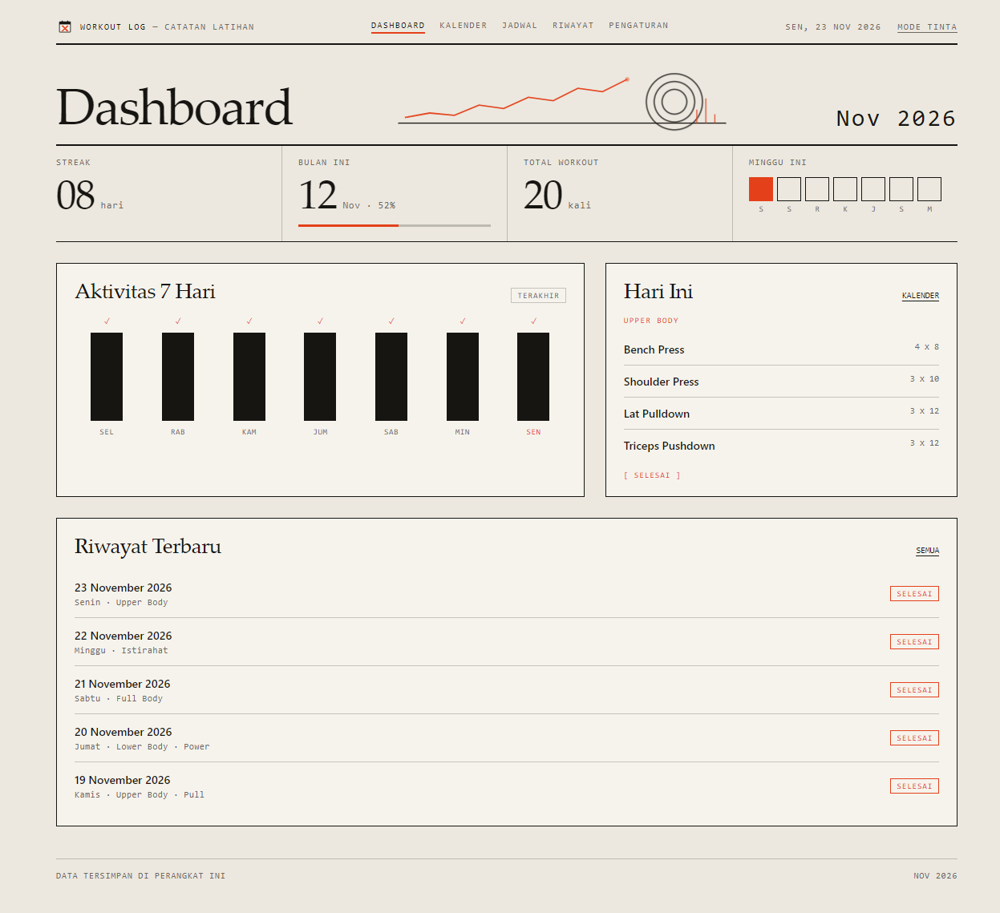
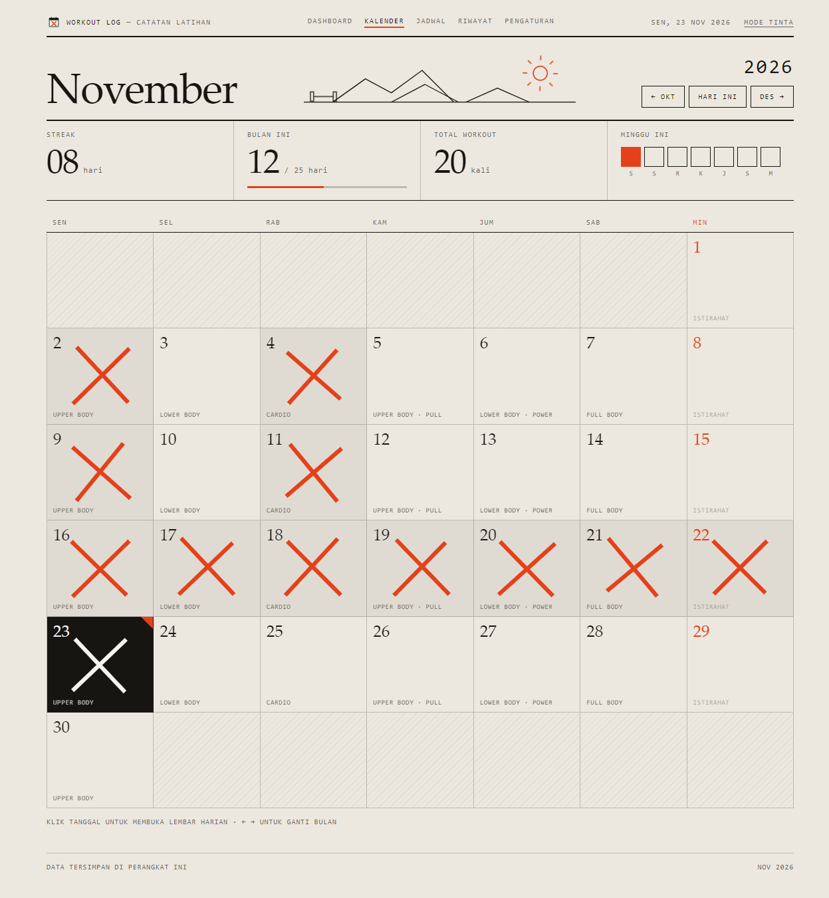
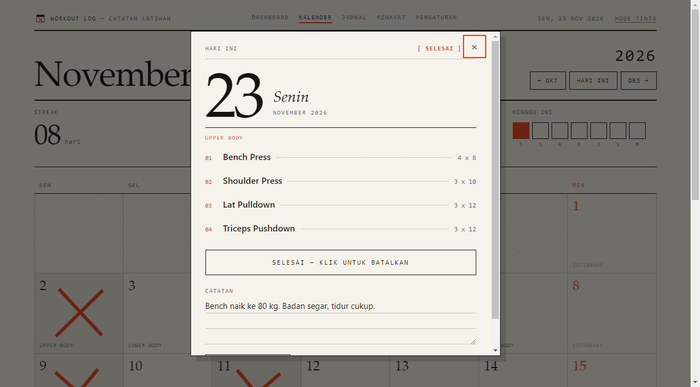
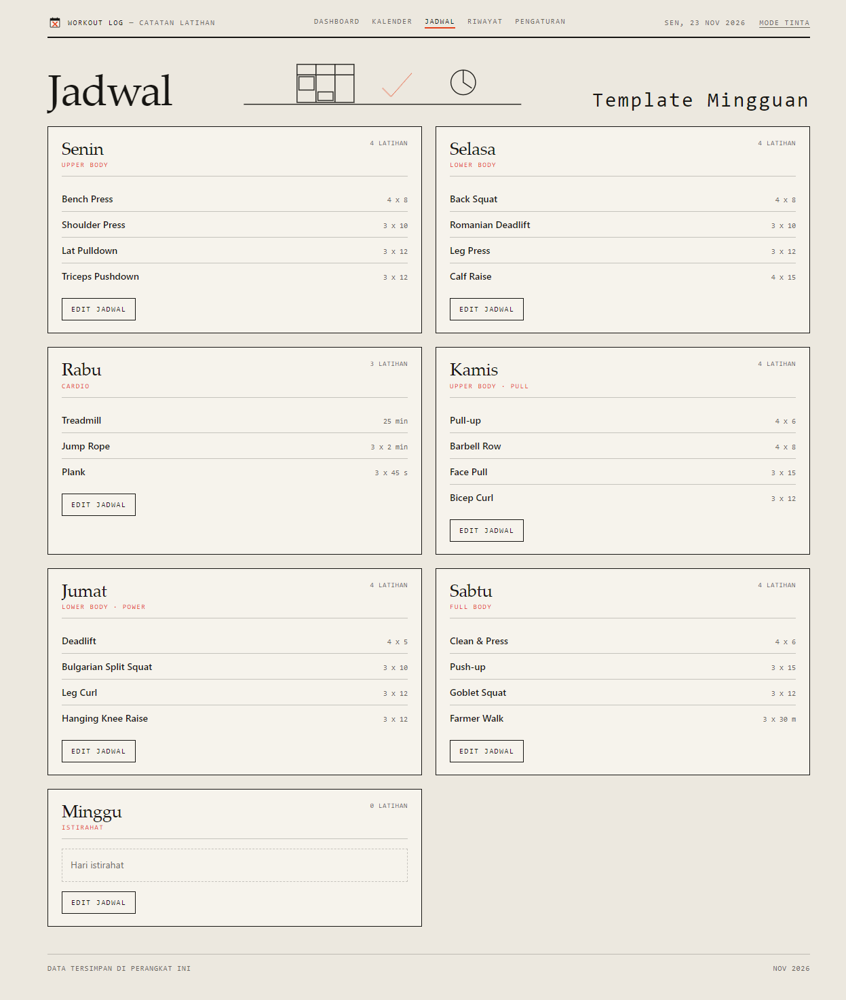
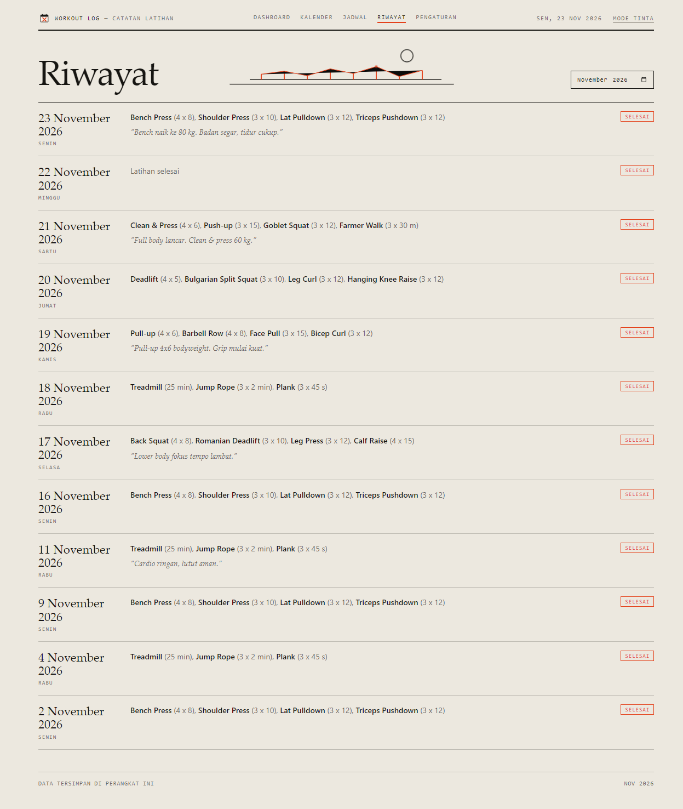
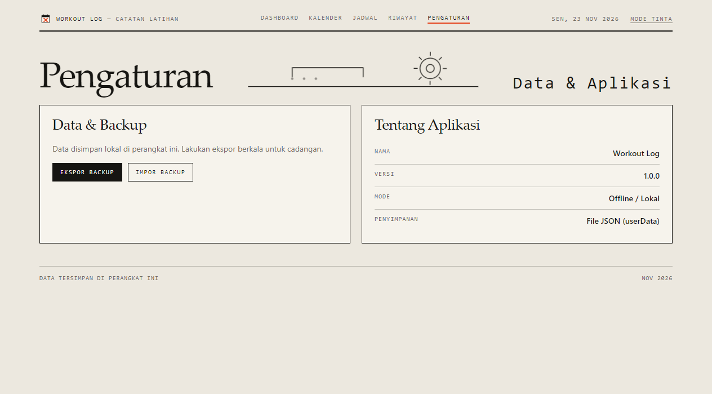
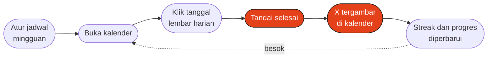
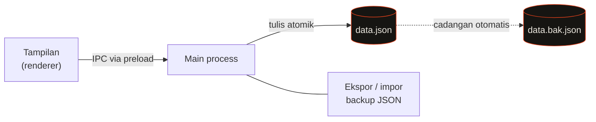

<div align="center">


<a href="https://github.com/Bim-git-hub/WorkOut-Plan">
  
</a>

<br>

[](https://github.com/Bim-git-hub/WorkOut-Plan/releases/latest)
[](https://github.com/Bim-git-hub/WorkOut-Plan/releases/latest)
[](#-data--privasi)
[](https://www.electronjs.org/)

<p>
  <a href="#-unduh"><b>⬇ Unduh</b></a>
  &nbsp;•&nbsp;
  <a href="#-preview"><b>Preview</b></a>
  &nbsp;•&nbsp;
  <a href="#-detail-yang-bergerak"><b>Gerak</b></a>
  &nbsp;•&nbsp;
  <a href="#-fitur"><b>Fitur</b></a>
  &nbsp;•&nbsp;
  <a href="#-cara-pakai"><b>Cara Pakai</b></a>
  &nbsp;•&nbsp;
  <a href="#-faq"><b>FAQ</b></a>
  &nbsp;•&nbsp;
  <a href="#-pengembangan"><b>Pengembangan</b></a>
</p>

</div>

---

## 🧩 Sekilas

**Workout Log** adalah aplikasi desktop untuk mencatat latihan tanpa ribet. Atur jadwal mingguan sekali, lalu setiap selesai latihan cukup klik tanggalnya. Sebuah **✕ merah tergambar di kalender**, streak bertambah, dan progres bulan ini langsung terlihat.

<table>
<tr>
<td align="center" width="25%"><h3>1 klik</h3><sub>untuk menandai<br>hari latihan selesai</sub></td>
<td align="center" width="25%"><h3>100% offline</h3><sub>tanpa akun, CDN,<br>atau telemetri</sub></td>
<td align="center" width="25%"><h3>2 tema</h3><sub>Kertas (terang) dan<br>Tinta (gelap)</sub></td>
<td align="center" width="25%"><h3>Data lokal</h3><sub>ekspor dan impor<br>backup JSON</sub></td>
</tr>
</table>

## ✨ Preview

<details open>
<summary><b>Lihat tampilan aplikasi</b></summary>
<br>

| Dashboard | Kalender |
| :---: | :---: |
|  |  |

| Lembar Harian | Jadwal |
| :---: | :---: |
|  |  |

<details>
<summary><b>Tampilan lainnya</b></summary>
<br>

| Riwayat | Pengaturan |
| :---: | :---: |
|  |  |

</details>

</details>

## 🎬 Detail yang Bergerak

Gerakan di aplikasi sengaja dibuat halus dan punya fungsi, bukan sekadar hiasan:

| Elemen | Gerakan |
| --- | --- |
| **Tanda ✕** | Dua goresan tergambar berurutan saat hari ditandai selesai. Kemiringan sedikit berbeda tiap tanggal, jadi terasa seperti dicoret tangan. |
| **Ganti bulan** | Grid kalender bergeser ke arah navigasi (kiri atau kanan), sehingga jelas Anda sedang maju atau mundur. |
| **Dashboard** | Garis tren di masthead tergambar saat halaman dibuka, sementara ilustrasinya berputar, mengambang, dan berdenyut pelan. |
| **Pindah halaman** | Tampilan baru muncul dengan fade dan geser ringan. |
| **Lembar harian** | Popup masuk dengan fade dan naik sedikit. |
| **Kurangi gerakan** | Semua animasi otomatis mati jika sistem operasi diatur ke "kurangi gerakan" (`prefers-reduced-motion`). |

**Satu putaran latihan:**



## 🧭 Fitur

<table>
<tr>
<td width="50%" valign="top">

### 📊 Dashboard
Ringkasan cepat progres latihan: streak, total workout, konsistensi bulan ini, aktivitas 7 hari, jadwal hari ini, dan riwayat terbaru.

</td>
<td width="50%" valign="top">

### 📅 Kalender
Grid bulanan dengan judul sesi per hari. Klik tanggal untuk membuka lembar harian, tandai selesai, atau tulis catatan.

</td>
</tr>
<tr>
<td width="50%" valign="top">

### 🗓 Jadwal Mingguan
Atur template latihan Senin–Minggu. Tambah latihan, set/reps, dan judul sesi seperti <i>Upper Body</i>, <i>Lower Body</i>, atau <i>Cardio</i>.

</td>
<td width="50%" valign="top">

### 📝 Lembar Harian
Popup harian untuk cek daftar latihan, menandai sesi selesai, menulis catatan beban/progres, dan mengedit jadwal hari tersebut.

</td>
</tr>
<tr>
<td width="50%" valign="top">

### 🕘 Riwayat
Lihat workout yang sudah selesai per bulan, lengkap dengan detail sesi dan catatan.

</td>
<td width="50%" valign="top">

### 🎨 Tema Kertas & Tinta
Dua tema editorial: **Kertas** (terang) dan **Tinta** (gelap). Ganti tema langsung dari topbar.

</td>
</tr>
</table>

## ⬇ Unduh

<div align="center">

[](https://github.com/Bim-git-hub/WorkOut-Plan/releases/latest/download/Workout-Log-Setup-1.0.0.exe)
[](https://github.com/Bim-git-hub/WorkOut-Plan/releases/latest/download/Workout-Log-1.0.0-portable.exe)

</div>

| Berkas | Cocok untuk | Catatan |
| --- | --- | --- |
| `Workout-Log-Setup-1.0.0.exe` | Instalasi normal | Pilih folder instalasi, buat shortcut desktop/start menu |
| `Workout-Log-1.0.0-portable.exe` | Pakai langsung | Tanpa instalasi, cocok dibawa di folder/drive |

> [!NOTE]
> Aplikasi belum ditandatangani digital. Jika Windows SmartScreen muncul, pilih **More info** lalu **Run anyway**.

## 🚀 Cara Pakai

<details open>
<summary><b>Alur cepat</b></summary>
<br>

1. **Atur jadwal**  
   Buka menu **Jadwal** → isi latihan tiap hari → beri judul sesi.
2. **Buka kalender**  
   Klik tanggal untuk membuka lembar harian.
3. **Tandai selesai**  
   Tekan **Tandai selesai** setelah latihan. Tambahkan catatan bila perlu.
4. **Pantau progres**  
   Cek **Dashboard** untuk streak/konsistensi, dan **Riwayat** untuk workout sebelumnya.
5. **Cadangkan data**  
   Buka **Pengaturan** → **Ekspor backup** secara berkala.

</details>

<details>
<summary><b>Pintasan keyboard</b></summary>
<br>

| Tombol | Aksi |
| --- | --- |
| `←` / `→` | Ganti bulan di Kalender |
| `Enter` / `Space` | Buka tanggal yang sedang difokuskan |
| `Esc` | Tutup popup lembar harian |

</details>

## 🔒 Data & Privasi

- **Offline penuh** — tidak ada CDN, telemetri, atau koneksi wajib.
- **Data lokal** — tersimpan di perangkat Anda:

```text
%APPDATA%\workout-tracker\data.json
```

- **Aman ditulis** — penyimpanan atomik dengan cadangan `data.bak.json`.
- **Backup manual** — ekspor/impor JSON dari menu Pengaturan.
- **Kompatibel** — format backup tetap kompatibel dengan prototipe `workout-tracker.html`.



## ❓ FAQ

<details>
<summary><b>Apakah butuh internet?</b></summary>
<br>

Tidak. Aplikasi berjalan sepenuhnya offline dan tidak mengirim data apa pun.

</details>

<details>
<summary><b>Di mana data latihan disimpan?</b></summary>
<br>

Di komputer Anda sendiri, pada `%APPDATA%\workout-tracker\data.json`.

</details>

<details>
<summary><b>Bagaimana memindahkan data ke komputer lain?</b></summary>
<br>

Buka **Pengaturan** → **Ekspor backup** di komputer lama, lalu **Impor backup** di komputer baru.

</details>

<details>
<summary><b>Kenapa Windows SmartScreen memperingatkan saya?</b></summary>
<br>

Aplikasi belum ditandatangani digital (code signing). Pilih **More info** lalu **Run anyway** untuk melanjutkan.

</details>

<details>
<summary><b>Saya sudah punya catatan dari prototipe <code>workout-tracker.html</code>. Bisa dipakai?</b></summary>
<br>

Bisa. Ekspor backup dari prototipe, lalu impor di aplikasi desktop lewat menu **Pengaturan**. Formatnya kompatibel.

</details>

## 🛠 Pengembangan

<details>
<summary><b>Jalankan dari source</b></summary>
<br>

**Prasyarat:** Node.js 18+, Windows.

```bash
cd workout-tracker
npm install

npm run dev      # mode pengembangan (hot reload)
npm test         # unit test
npm run build    # build renderer/main/preload
npm run dist     # buat installer + portable di folder release/
```

</details>

<details>
<summary><b>Struktur proyek</b></summary>
<br>

```text
workout-tracker/
├── electron/            # main process + preload (IPC, penyimpanan atomik)
├── src/
│   ├── lib/             # tipe data, tanggal, storage, migrasi
│   ├── modules/         # dashboard, kalender, jadwal, riwayat, notepad, stats, xmark
│   ├── assets/          # logo aplikasi
│   ├── main.ts          # routing, tema, modal
│   └── styles.css       # tema Kertas & Tinta
├── build/               # ikon aplikasi (SVG + PNG)
├── docs/screenshots/    # screenshot untuk README
├── tests/               # unit test (Vitest)
└── index.html
```

</details>

<details>
<summary><b>Stack & keamanan</b></summary>
<br>

| Bagian | Teknologi |
| --- | --- |
| Desktop shell | Electron 30 |
| Bundler/dev | electron-vite + Vite + TypeScript |
| UI | Vanilla TypeScript + CSS |
| Test | Vitest |
| Packaging | electron-builder (NSIS + portable) |

Keamanan Electron:
- `contextIsolation: true`
- `nodeIntegration: false`
- Akses file hanya lewat IPC preload

</details>

---

<div align="center">

**Data tetap milik Anda. Latihan tetap konsisten.**

<sub>Dibuat dengan Electron + TypeScript • [Laporkan issue](https://github.com/Bim-git-hub/WorkOut-Plan/issues)</sub>

<br>

<sub>Banner dan teks mengetik di README ini dirender oleh <a href="https://github.com/kyechan99/capsule-render">capsule-render</a> dan <a href="https://github.com/DenverCoder1/readme-typing-svg">readme-typing-svg</a>. Keduanya hanya tampil di halaman GitHub, tidak dipakai aplikasi, yang tetap 100% offline.</sub>


</div>
